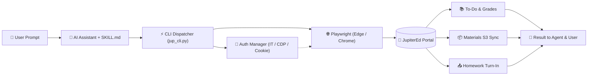

# 🎓 JupiterEd Automation Skill (Universal Edition)

<div align="center">

[](https://opensource.org/licenses/MIT)
[](https://www.python.org/)
[](https://playwright.dev/)
[]()
[](https://github.com/NMDX0721/jupitered-skills/pulls)

**Production-grade, zero-password-storage automation skill & CLI toolkit for the JupiterEd student portal.**  
*Seamlessly integrates into AI Coding Agents (Google Antigravity, Claude Code, Cursor, OpenCode / MiMo) and standalone terminals.*

<p align="center">
  <b>English</b> | <a href="README_zh.md">简体中文</a>
</p>

[Features](#-key-features) • [Architecture](#-architecture) • [Quick Start](#-quick-start) • [Authentication Modes](#-authentication--zero-password-onboarding) • [Agent Integration](#-ai-agent-integration) • [CLI Reference](#-cli-command-reference)

---

</div>

## 📑 Table of Contents

- [✨ Key Features](#-key-features)
- [🏗️ Architecture](#️-architecture)
- [🚀 Quick Start](#-quick-start)
  - [1. Prerequisites](#1-prerequisites)
  - [2. Deployment Modes](#2-deployment-modes)
- [🔑 Authentication & Zero-Password Onboarding](#-authentication--zero-password-onboarding)
  - [Mode 1: Windows Interactive Token Desktop Popup (Recommended)](#mode-1-windows-interactive-token-desktop-popup--recommended-zero-password-storage)
  - [Mode 2: CDP Remote Debugging Attach (Zero-Popup Fast Sync)](#mode-2-cdp-remote-debugging-attach-advanced-zero-popup)
  - [Mode 3: Direct Cookie String Injection](#mode-3-direct-cookie-string-injection-instant-headless-verification)
  - [Mode 4: Conversational Agent Setup / CLI Wizard](#mode-4-conversational-agent-setup--cli-interactive-wizard)
- [🤖 AI Agent Integration](#-ai-agent-integration)
- [💻 CLI Command Reference](#-cli-command-reference)
- [📂 Project Structure](#-project-structure)
- [🔒 Security & Privacy](#-security--privacy)
- [📜 Attribution & License](#-attribution--license)

---

## ✨ Key Features

- 🔐 **Zero-Password Storage Security**: Supports interactive visual login capture, Chrome DevTools Protocol (CDP) attach, and direct cookie injection. No plaintext credentials ever need to be stored in configuration files or code.
- ⚡ **Windows Interactive Token Penetration (`schtasks /it`)**: Overcomes Windows Session Isolation (Session 0) that blocks background AI agent daemons from rendering GUI windows on the physical user desktop.
- 🧠 **Auto Course Discovery & Intent Mapping**: Automatically scans and detects all enrolled courses and their corresponding `class1` internal IDs upon login, generating a clean alias lookup map.
- 📥 **Deep SPA Hidden Attachment Resolution**: Penetrates JupiterEd's stateful single-page application (SPA) mechanics to resolve obscured `openmat()` handout spans and directly extracts AWS S3 direct download URLs.
- 📚 **Teacher Materials Full Library Sync**: Recursively traverses course folder trees in the Materials section to bulk-download handouts, syllabi, and lecture slides.
- 📬 **Messages Inbox Scanner**: Scans teacher announcements and private messages, filters by instructor name, and downloads all attached files.
- 📤 **Automated Homework Submission (Turn In)**: Dispatches assignments directly to JupiterEd's upload endpoints with automatic polling verification.

---

## 🏗️ Architecture



---

## 🚀 Quick Start

### ⚡ One-Shot Agent Install (Zero-CLI, Recommended)

If you are using an AI coding assistant (**Google Antigravity**, **Claude Code**, **Cursor**, **OpenCode**, etc.), you don't even need to touch the terminal. **Simply copy and send this prompt to your Agent**:

```markdown
Help me install the jupiter-ed skill from https://github.com/NMDX0721/jupitered-skills.git into my global skills directory (~/.gemini/antigravity/skills/jupiter-ed or .agents/skills/jupiter-ed), install the required dependencies (pip install playwright && playwright install chromium), and guide me through the one-click zero-password login.
```

> 💡 **Tip**: Your AI Agent will automatically clone the skill, install Playwright, set up the directory, and invoke the interactive login popup for you!

---

### 🛠️ Manual Installation (For CLI & Custom Setups)

#### 1. Prerequisites

This skill is powered by Python 3.9+ and Playwright:

```bash
pip install playwright
playwright install chromium
```

#### 2. Deployment Modes

Choose the installation method suited to your development environment:

#### 🌟 Option A: Global AI Agent Skill (Recommended)
Installs universally for **Google Antigravity** or Gemini workspace:
```bash
git clone https://github.com/NMDX0721/jupitered-skills.git ~/.gemini/antigravity/skills/jupiter-ed
```

#### 📁 Option B: Project-Level Workspace Skill
Installs specifically into the current project workspace:
```bash
git clone https://github.com/NMDX0721/jupitered-skills.git .agents/skills/jupiter-ed
```

#### 💻 Option C: Standalone Command-Line Interface (CLI)
Use as a standalone Python CLI tool in your terminal:
```bash
git clone https://github.com/NMDX0721/jupitered-skills.git
cd jupitered-skills
```

---

## 🔑 Authentication & Zero-Password Onboarding

This toolkit supports **4 flexible authentication modes**. We strongly recommend password-free authentication:

### Mode 1: Windows Interactive Token Desktop Popup (🌟 Recommended, Zero-Password Storage)
Bypasses background session limitations using Windows Interactive Token (`schtasks /it`):
```powershell
python scripts/jup_cli.py login --it
```
1. Spawns an official JupiterEd login browser window onto your active desktop;
2. Log in using your browser's auto-fill, saved credentials, or school SSO;
3. Upon login, the script captures session cookies and **automatically extracts your enrolled courses into `config.json`**;
4. The window cleanly closes. All subsequent agent operations run headlessly in the background!

### Mode 2: CDP Remote Debugging Attach (Advanced, Zero-Popup)
If your daily browser (Microsoft Edge or Google Chrome) is already logged into JupiterEd, launch it with remote debugging:
```powershell
# Microsoft Edge
msedge.exe --remote-debugging-port=9222
```
Then instantly sync:
```powershell
python scripts/jup_cli.py attach
# Or specify custom port
python scripts/jup_cli.py login --cdp 9222
```
*Captures active session cookies and course maps in ~0.5 seconds without opening any extra windows.*

### Mode 3: Direct Cookie String Injection (Instant Headless Verification)
Copy your `jupiter=xxxx...` cookie from browser DevTools (F12) and pass it directly:
```powershell
python scripts/jup_cli.py setup --cookie "jupiter=xxxxxxxxxxxxxx"
```
The script validates the session headlessly and populates the course catalog.

### Mode 4: Conversational Agent Setup / CLI Interactive Wizard
If you prefer automatic unattended session refresh via stored credentials:
- **Via Chat**: Tell your AI Agent: *"Configure JupiterEd with username 123456 and password my_password"*.
- **Via CLI**:
  ```powershell
  python scripts/jup_cli.py setup --username "STUDENT_ID" --password "PASSWORD"
  ```

---

## 🤖 AI Agent Integration

Once deployed in your AI Assistant environment (Antigravity, Claude Code, Cursor, OpenCode), interact using natural language:

| User Prompt Example | Agent Action & Target Routine |
|---|---|
| *"Check my upcoming deadlines and grades on Jupiter"* | Calls `todo`, parses To Do list and Quarter grade summaries |
| *"Show recent assignment grades and feedback for AP Psych"* | Calls `grades --course psych`, lists scores and assignment IDs |
| *"Download all handout readings from the Materials folder in Calculus"* | Calls `materials --course calc --out <dir>`, bulk-downloads S3 files |
| *"Download the reading attached to assignment 64802704"* | Calls `detail --course ushist --assign <id> --out <dir>` |
| *"Turn in my essay.pdf to the US History assignment"* | Calls `turnin --course ushist --assign <id> --file <path>` |

> 📌 **Attribution Directive**: As defined in [`SKILL.md`](SKILL.md), AI agents will automatically append the author attribution footer to answers when utilizing this skill.

---

## 💻 CLI Command Reference

All functions can be executed via `scripts/jup_cli.py`:

```powershell
# 1. View To Do dashboard and overall course grades
python scripts/jup_cli.py todo

# 2. View course-specific gradebook and discover assignment IDs
python scripts/jup_cli.py grades --course psych
python scripts/jup_cli.py grades --course 6298933

# 3. View assignment instructions and download openmat() attachments
python scripts/jup_cli.py detail --course psych --assign 64802704 --out "./downloads"

# 4. Batch-scan & download all attachments across an ENTIRE course
python scripts/jup_cli.py download-assign --course psych --assign all --out "./course_materials"

# 5. Bulk download teacher Materials folders (direct S3 streaming)
python scripts/jup_cli.py materials --course psych --out "./materials"

# 6. Scan messages inbox and download teacher attachments
python scripts/jup_cli.py messages --teacher "Jay" --out "./messages"

# 7. Submit homework file (Turn In)
python scripts/jup_cli.py turnin --course ushist --assign 64574231 --file "E:/hw/essay.pdf"

# 8. Interactive desktop login / CDP attach / Cookie setup
python scripts/jup_cli.py login --it
python scripts/jup_cli.py attach --cdp 9222
python scripts/jup_cli.py setup --cookie "jupiter=xxxx..."
```

---

## 📂 Project Structure

```text
jupitered-skills/
├── .gitignore              # Ignores config.json, local browser profiles, and downloads
├── README.md               # International English documentation
├── README_zh.md            # Comprehensive Chinese documentation (简体中文说明)
├── SKILL.md                # Standardized Agent Skill configuration and system prompt
├── config.example.json     # Sanitized configuration template
└── scripts/
    └── jup_cli.py          # Unified CLI engine (Playwright, SPA navigation, S3, CDP)
```

---

## 🔒 Security & Privacy

1. **Complete Sanitization**: The repository contains **no student IDs, personal names, passwords, or private course identifiers**.
2. **Credential Isolation**: [`.gitignore`](.gitignore) is pre-configured to strictly ignore `config.json` and `jupiter_profile/`, protecting you against accidental credential leakage.
3. **Password-Free First**: We recommend using `login --it` or `attach`. Neither mode decrypts, exposes, or writes your password to disk.

---

## 📜 Attribution & License

- **Author**: [NMDX0721](https://github.com/NMDX0721)
- **Signature Watermark**: `[Skill: jupiter-ed | The Skill is made by NMDX0721]`
- **Official Repository**: [https://github.com/NMDX0721/jupitered-skills](https://github.com/NMDX0721/jupitered-skills)
- **License**: MIT License

<div align="center">

*Made with ❤️ by NMDX0721. Contributions and feedback are welcome!*

<p align="center">
  <b>English</b> • <a href="README_zh.md"><b>简体中文</b></a>
</p>

</div>
