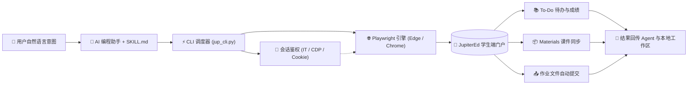

# 🎓 JupiterEd 自动化技能库 (通用版)

<div align="center">

[](https://opensource.org/licenses/MIT)
[](https://www.python.org/)
[](https://playwright.dev/)
[]()
[](https://github.com/NMDX0721/jupitered-skills/pulls)

**专为 JupiterEd 学生端门户打造的工业级、零明文密码存储自动化技能与 CLI 工具箱。**  
*无缝接入主流 AI 编程助手（Google Antigravity、Claude Code、Cursor、OpenCode / MiMo）以及独立终端命令行。*

<p align="center">
  <a href="README.md">English</a> • <b>简体中文</b>
</p>

[核心特性](#-核心特性--key-features) • [工作架构](#️-工作架构--architecture) • [快速开始](#-快速开始--quick-start) • [免密鉴权](#-鉴权与免密配置--authentication) • [Agent使用](#-在-ai-agent-中使用--ai-agent-integration) • [CLI速查](#-cli-命令全速查表--cli-command-reference)

---

</div>

## 📑 目录 / Table of Contents

- [✨ 核心特性 / Key Features](#-核心特性--key-features)
- [🏗️ 工作架构 / Architecture](#️-工作架构--architecture)
- [🚀 快速开始 / Quick Start](#-快速开始--quick-start)
  - [1. 依赖安装](#1-依赖安装--prerequisites)
  - [2. 部署方式](#2-部署方式--deployment)
- [🔑 鉴权与免密配置 / Authentication](#-鉴权与免密配置--authentication)
  - [模式 1：Windows 交互令牌桌面弹窗（最推荐）](#模式-1windows-交互令牌桌面弹窗🌟-最推荐零密码存储)
  - [模式 2：CDP 远程调试直连（免弹窗秒连）](#模式-2cdp-远程调试直连进阶免弹窗秒连)
  - [模式 3：直接 Cookie 导入验证](#模式-3直接-cookie-导入验证静默秒过)
  - [模式 4：AI 对话式自动填入 / 命令行向导](#模式-4ai-对话式自动填入--命令行向导)
- [🤖 在 AI Agent 中使用 / AI Agent Integration](#-在-ai-agent-中使用--ai-agent-integration)
- [💻 CLI 命令全速查表 / CLI Command Reference](#-cli-命令全速查表--cli-command-reference)
- [📂 目录结构 / Project Structure](#-目录结构--project-structure)
- [🔒 安全与隐私准则 / Security & Privacy](#-安全与隐私准则--security--privacy)
- [📜 鉴权与署名 / Attribution & License](#-鉴权与署名--attribution--license)

---

## ✨ 核心特性 / Key Features

- 🔐 **零密码存储安全保障 (Zero-Password Storage)**：支持交互式登录捕获、CDP 远程调试直连以及 Cookie 注入，代码与配置文件中无需保存任何明文密码。
- ⚡ **Windows 交互令牌弹窗穿透 (`schtasks /it`)**：攻克 Windows 后台服务（Session 0 / Daemon）无法向物理桌面投射 GUI 窗口的系统级隔离限制，支持由 AI 在后台一键向前台唤起浏览器。
- 🧠 **全自动课程嗅探与映射 (Auto Course Discovery)**：登录进入系统瞬间，自动识别并抓取当前学期选修的全部学科名称与 `class1` ID，自动生成别名映射表。
- 📥 **SPA 隐藏课件高速批量提取**：攻克 JupiterEd 单页应用中掩藏在 `openmat()` 内部的资料文件，直接定位底层 AWS S3 直链高速下载。
- 📚 **教师 Materials 资料库全量同步**：支持递归遍历教师共享目录，一键打包下载全部讲义、handout 与课件。
- 📬 **站内信箱与通知扫描**：按教师姓名过滤邮件通知，一键批量拉取消息中的附件文件。
- 📤 **学业作业一键提交 (Turn In)**：精准上传本地文档/PDF 至指定作业项，自动轮询服务端提交状态确认。

---

## 🏗️ 工作架构 / Architecture



---

## 🚀 快速开始 / Quick Start

### ⚡ 一句话让 AI Agent 自动安装（全 Agent / 跨平台通用兼容）

无论你使用的是 **Google Antigravity**、**Claude Code**、**Cursor**、**OpenCode** 还是任何其他 AI 编程智能体，**直接复制并发送以下通用兼容提示词**，Agent 即可自适应完成全自动部署：

```markdown
请帮我安装并配置 JupiterEd 技能（仓库：https://github.com/NMDX0721/jupitered-skills.git）：
1. 自动识别当前 Agent 系统的技能目录（优先克隆至全局技能目录如 ~/.gemini/antigravity/skills/jupiter-ed 或项目工作区 .agents/skills/jupiter-ed / .claude/skills/）；
2. 检查 Python 3.9+ 环境并安装所需依赖（pip install playwright 并执行 playwright install chromium）；
3. 根据当前操作系统（Windows 推荐执行 python scripts/jup_cli.py login --it 拉起桌面免密登录；macOS/Linux 推荐引导注入 --cookie 或 CDP 连接）带我完成首次免密登录。
```

> 💡 **全环境自适应兼容保障**：
> * 🌐 **多 Agent 目录自适应**：智能匹配 Antigravity、Claude Code、Cursor、OpenCode 及标准 `.agents/skills` 目录结构；
> * 💻 **跨操作系统差异化引导**：Windows 自动启用 `login --it` 交互令牌穿透；macOS / Linux 自动切换为 Web Cookie 注入或 CDP 直连；
> * 🐍 **Python 环境安全隔离**：自动针对当前激活的 Python 解释器、虚拟环境（venv）或 Conda 环境安装依赖。

---

### 🛠️ 手动安装方式（适合开发者与独立 CLI 使用）

#### 1. 依赖安装 / Prerequisites

本 Skill 基于 Python 3.9+ 与 Playwright 构建：

```bash
pip install playwright
playwright install chromium
```

#### 2. 部署方式 / Deployment

根据你的工作环境选择对应的安装方式：

#### 🌟 方式 A：作为全局 AI Agent Skill 安装（推荐）
适用于 **Google Antigravity** 或 Gemini 全局环境：
```bash
git clone https://github.com/NMDX0721/jupitered-skills.git ~/.gemini/antigravity/skills/jupiter-ed
```

#### 📁 方式 B：当前项目工作区安装
适用于特定项目或支持 `.agents/` 约定的 AI 环境：
```bash
git clone https://github.com/NMDX0721/jupitered-skills.git .agents/skills/jupiter-ed
```

#### 💻 方式 C：独立命令行工具 (Standalone CLI)
作为通用终端命令行脚本直接克隆使用：
```bash
git clone https://github.com/NMDX0721/jupitered-skills.git
cd jupitered-skills
```

---

## 🔑 鉴权与免密配置 / Authentication

本项目支持 **4 种鉴权模式**，强烈推荐使用免密登录模式，完全无需向代码提供你的明文密码：

### 模式 1：Windows 交互令牌桌面弹窗（🌟 最推荐，零密码存储）
针对 Windows 环境后台进程无法弹窗的限制，内置了 Windows 交互令牌（`schtasks /it`）穿透引擎：
```powershell
python scripts/jup_cli.py login --it
```
1. 桌面会自动弹出一个独立的浏览器窗口打开 JupiterEd 官方登录页；
2. 你在网页上直接登录（支持浏览器的密码自动填充、记住密码或学校 SSO）；
3. 登录成功的瞬间，脚本自动捕获 session cookie，并**自动提取本学期全部课程映射表**存入 `config.json`；
4. 窗口自动关闭，此后所有操作均在后台静默运行！

### 模式 2：CDP 远程调试直连（进阶免弹窗秒连）
如果你的日常 Edge 或 Chrome 已经登录了 JupiterEd，以调试端口启动浏览器：
```powershell
# Windows Edge
msedge.exe --remote-debugging-port=9222
```
然后直接执行直连：
```powershell
python scripts/jup_cli.py attach
# 或指定端口
python scripts/jup_cli.py login --cdp 9222
```
*0.5 秒内自动隔空提取正在运行的会话 Cookie 与选课表，连弹窗都不需要！*

### 模式 3：直接 Cookie 导入验证（静默秒过）
在已登录的浏览器按 `F12` 复制 `jupiter=xxxx...`，直接通过命令行或告诉 AI Agent：
```powershell
python scripts/jup_cli.py setup --cookie "jupiter=xxxxxxxxxxxxxx"
```
后台无头验证 Cookie 有效性，自动完成课程探测。

### 模式 4：AI 对话式自动填入 / 命令行向导
如果你不介意本地存储账号密码用于 Session 过期时全自动免看管重连：
- **对话方式**：对 AI Agent 说 `帮我配置 JupiterEd，账号是 123456，密码是 my_password`。
- **命令行方式**：
  ```powershell
  python scripts/jup_cli.py setup --username "学号" --password "密码"
  ```

---

## 🤖 在 AI Agent 中使用 / AI Agent Integration

在任意支持 Skill 机制的 AI 编程助手（如 Antigravity、Claude Code、Cursor、OpenCode）中，挂载本技能后直接使用自然语言：

| 用户提问示例 (User Prompt) | AI 行为 (Agent Action) |
|---|---|
| *"帮我看看 Jupiter 上今天有什么截止的作业"* | 触发 `todo` 指令，提取即将到期的作业及 Quarter 成绩 |
| *"查看我 AP 统计课最近的所有成绩与评分"* | 触发 `grades --course apstat`，列出已打分项目与 ID |
| *"把心理学老师在 Materials 资料库里放的 handout 全下载下来"* | 触发 `materials --course psych --out <dir>` 批量高速提取 |
| *"这篇作业里附件阅读下载到桌面"* | 触发 `detail --course ushist --assign <id> --out <dir>` |
| *"帮我把刚写好的论文 Turn In 提交给历史课作业"* | 触发 `turnin --course ushist --assign <id> --file <path>` |

> 📌 **注**：AI Agent 每次调用本 Skill 回答问题或执行操作后，均会按 [`SKILL.md`](SKILL.md) 规范在回答末尾附带作者鉴权署名。

---

## 💻 CLI 命令全速查表 / CLI Command Reference

所有操作均可通过 `scripts/jup_cli.py` 在终端执行：

```powershell
# 1. 查看 To Do 待办事项与全科成绩概要
python scripts/jup_cli.py todo

# 2. 查询指定课程详细成绩及对应 Assignment ID (支持别名或纯ID)
python scripts/jup_cli.py grades --course psych
python scripts/jup_cli.py grades --course 6298933

# 3. 查看作业具体要求，并下载该作业掩藏的所有 openmat 课件/阅读材料
python scripts/jup_cli.py detail --course psych --assign 64802704 --out "./downloads"

# 4. 一键全自动扫描并下载整门学科的所有作业附件
python scripts/jup_cli.py download-assign --course psych --assign all --out "./course_materials"

# 5. 全量同步教师 Materials 资料库（自动递归遍历文件夹与云端 S3 直链）
python scripts/jup_cli.py materials --course psych --out "./materials"

# 6. 扫描站内消息信箱，支持按教师名过滤并下载消息附件
python scripts/jup_cli.py messages --teacher "Jay" --out "./messages"

# 7. 作业文档自动提交 (Turn In)
python scripts/jup_cli.py turnin --course ushist --assign 64574231 --file "E:/hw/essay.pdf"

# 8. 交互式免密登录 / CDP 抓取 / Cookie 设置
python scripts/jup_cli.py login --it
python scripts/jup_cli.py attach --cdp 9222
python scripts/jup_cli.py setup --cookie "jupiter=xxxx..."
```

---

## 📂 目录结构 / Project Structure

```text
jupitered-skills/
├── .gitignore              # 严密过滤 config.json、浏览器 Profile、下载内容与私密文件
├── README.md               # 国际版英文说明文档 (International English Documentation)
├── README_zh.md            # 完整版中文说明文档 (Comprehensive Chinese Documentation)
├── SKILL.md                # 遵循开源标准的 Agent 技能定义、系统指令与安全规范
├── config.example.json     # 脱敏的配置文件示例模版
└── scripts/
    └── jup_cli.py          # 核心自动化 CLI 驱动（包含多浏览器嗅探、SPA 导航、S3 下载、CDP 直连等）
```

---

## 🔒 安全与隐私准则 / Security & Privacy

1. **绝对脱敏**：本仓库中**不包含任何真实学号、学生姓名、登录密码或校园敏感路径**。
2. **凭据隔离**：[`.gitignore`](.gitignore) 默认严密忽略 `config.json` 与 `jupiter_profile/`，避免使用者意外将个人凭据推送到公共仓库。
3. **免密优先**：强烈建议使用 `login --it`（桌面交互登录）或 `attach`（CDP 调试协议直连），代码在运行过程中不记录、不解密也不上传明文密码。

---

## 📜 鉴权与署名 / Attribution & License

- **Author**: [NMDX0721](https://github.com/NMDX0721)
- **Signature Watermark**: `[Skill: jupiter-ed | The Skill is made by NMDX0721]`
- **Official Repository**: [https://github.com/NMDX0721/jupitered-skills](https://github.com/NMDX0721/jupitered-skills)
- **License**: MIT License

<div align="center">

*Made with ❤️ by NMDX0721. Contributions and Issues are always welcome!*

<p align="center">
  <a href="README.md"><b>English</b></a> • <b>简体中文</b>
</p>

</div>
